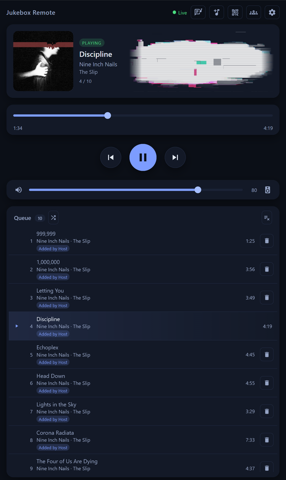
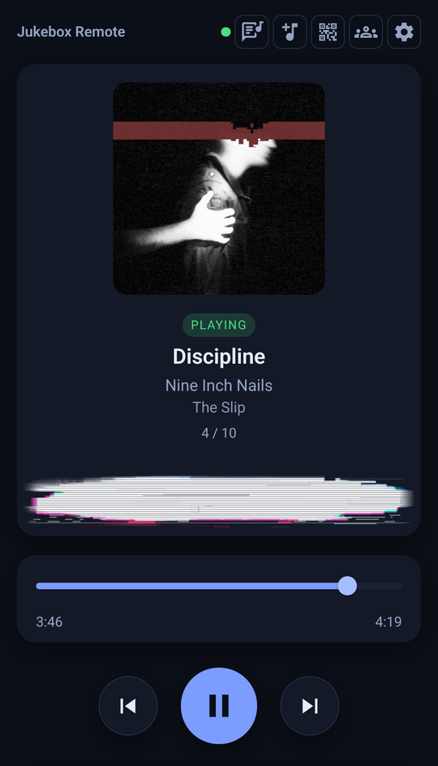
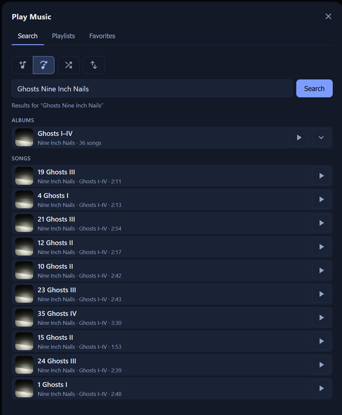
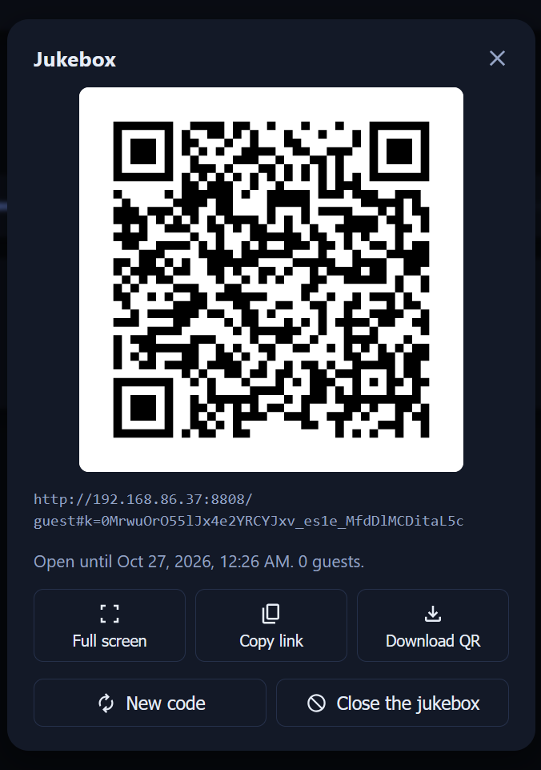
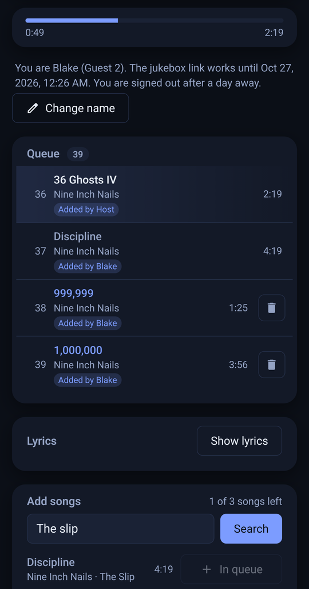
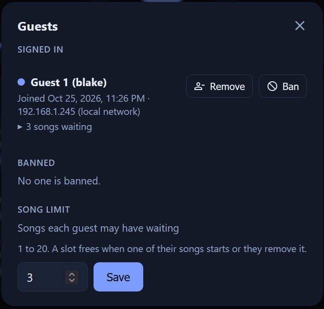
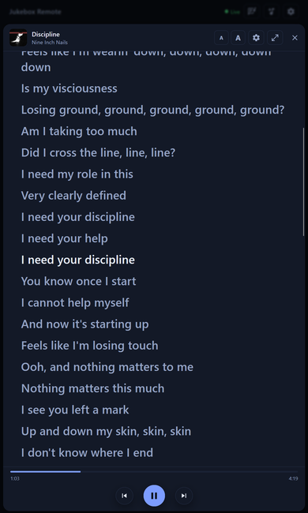

# Navidrome MCP Server

An MCP (Model Context Protocol) server for Navidrome. Claude Desktop, Claude Code, Cursor, and other MCP clients can browse your library, build playlists, discover new music, and play audio through your machine's speakers.

Navidrome MCP is an independent third-party project. It is not affiliated with or endorsed by the Navidrome project.

## Contents

- [Features](#features)
- [Tools](#tools)
- [Install](#install)
- [Jukebox Remote](#jukebox-remote)
  - [Commands](#commands)
  - [Player Lifetime](#player-lifetime)
  - [Phone and Tablet](#phone-and-tablet)
  - [Access Modes](#access-modes)
- [Guest Jukebox](#guest-jukebox)
  - [Setup](#setup)
  - [Host Songs](#host-songs)
  - [Managing Guests](#managing-guests)
- [Changing Settings](#changing-settings)
- [Troubleshooting](#troubleshooting)
- [More Docs](#more-docs)
- [License](#license)
- [Support](#support)

## Features

### 🎵 Music Library

Browse and search songs, albums, artists, genres, and tags. The filters for query, starred status, a single year, sort order, and tag values combine in one request, such as *"all my starred jazz albums from 1994"* or *"every song tagged Soundtrack with a 5-star rating"*. Tag analysis tools show what is in your library, so you don't have to guess at filter values.

### 🔊 Local Audio Playback

> Requires [`mpv`](https://mpv.io/) on the machine running the MCP server, as [Install](#install) describes.

Audio plays through that machine's speakers with no browser or Navidrome web UI. Search and play in one step, such as *"play 5 random starred albums"*, *"queue everything I've starred from 1994"*, or *"add 10 random rock songs to whatever's already playing, shuffled"*. Album playback can shuffle the album order, the tracks, or both.

Reorder or shuffle the queue during playback without interrupting the current song. Saved Navidrome radio stations play through mpv and show the song the station is playing. Plays scrobble back to Navidrome, so play counts and recent activity stay in sync. mpv starts on first use and can keep playing across MCP client restarts, as [Player Lifetime](#player-lifetime) describes. Playback works on Linux, macOS, and Windows 11.

A Raspberry Pi or an always-on machine with speech to text (such as Whisper) and text to speech works as a hands-free music player.

### 🎛️ Jukebox Remote (Web UI)

> Requires `mpv`.

A web player at `http://localhost:8808/admin` controls local playback from any browser. It shows the current song with cover art, transport and seek controls, volume, and a live queue. Click a queue entry to jump to it, or press its remove button to take it out of the queue. The output button beside the volume slider picks the audio output. Enable **Expose on LAN** to use the player from a phone or tablet. [Jukebox Remote](#jukebox-remote) covers its commands, lifetime, and access modes.

<p>
  <a href="images/remote-large.png"></a>
  <a href="images/remote-phone-large.png"></a>
</p>

The **Play Music** window searches artists, albums, and songs. An artist expands to its albums, and an album to its songs. The window also starts any playlist, your starred songs, or your starred albums. Each pick adds to the queue or replaces it, with an option to shuffle songs or albums. So the page works as a remote without the assistant.

[](images/play-music-large.png)

### 🎉 Guest Jukebox

> Requires `mpv` and the **Admin password and jukebox** access mode.

Guests scan a QR code and add songs to the end of the queue from their phones. Each guest can have 3 songs waiting at a time, and you can change that limit. The jukebox code works for the time you pick, up to 90 days. Then every guest is signed out. The **Guests** dialog lists the guests and can remove or ban one. [Guest Jukebox](#guest-jukebox) covers setup.

<p>
  <a href="images/jukebox-code-large.png"></a>
  <a href="images/guest-phone-large.png"></a>
  <a href="images/guests-large.png"></a>
</p>

### 🌈 Visualizer

The visualizer beside the track info moves with the music. It has 19 styles. Click it to switch to the next style, and the style's name shows for a moment. Each device keeps its own style. The images below show four of them.

<p>
  
  
  
  
</p>

### 🎶 Playlists

Create, update, reorder, and delete playlists. Add songs, entire albums, artist discographies, or specific discs in one operation. Find which playlists contain a song. Build playlists from listening data, such as *"a 'Hidden Gems' playlist of 5-star songs with under 5 plays"* or *"one top track from each album of my top 10 artists, in chronological order"*.

### 🎼 Music Discovery (Last.fm)

> Requires a Last.fm API key, free at [last.fm/api](https://www.last.fm/api/account/create) and set in the settings page.

Find similar artists and tracks, read biographies and top tracks, and browse global charts. With your library in the mix, you can ask for missing albums or overlooked music, such as *"albums missing from my top 5 artists, ranked by popularity"* or *"tracks similar to my favorites that I own but never play"*. You can also build "Best Of" playlists from what you own.

### 🎤 Synchronized Lyrics

> LRCLIB is set in the settings page and needs no API key. Lyrics stored in your files work without it.

Lyrics come from the audio file's tags and from LRCLIB's community database. Timed lyrics take priority over plain text. Within each kind, the file's lyrics come before LRCLIB's.

The web player's lyrics view highlights the current line and scrolls to follow it. Click a line to jump playback there. Scroll to read ahead. Then a button returns the view to the current line. The view fills the page or opens as a window over the player. Font size and sync offset are adjustable, and each device keeps its own choices. The screen stays awake while the view is open and music plays.

[](images/lyrics-large.png)

### 📻 Internet Radio

Manage Navidrome radio stations and discover new ones worldwide. `create_radio_station` checks each stream before adding it when `validateBeforeAdd` is set. `validate_radio_stream` checks any public http(s) URL on demand. The checks detect MP3, AAC, OGG, and FLAC streams. They also read SHOUTcast and Icecast metadata. Private, loopback, and link-local addresses are refused. Bulk maintenance works too, such as *"validate all my stations and remove the broken ones"* or *"test these 10 URLs and add the working ones"*.

Global discovery uses Radio Browser and needs a user agent, set in the settings page. It searches thousands of stations by genre, country, language, codec, bitrate, and popularity. Your votes and clicks count toward Radio Browser's community ranking.

### 📊 Listening Analytics

See play counts, recent activity, top-rated and most-played lists, and tag distribution across your library. Use them to find forgotten favorites and one-hit wonders, or to build mood playlists from your listening patterns.

### ⭐ Ratings & Favorites

Star and unstar songs, albums, and artists. Set 0-5 star ratings and list everything starred or top-rated. Read and write the saved queue that Navidrome's own web UI uses to sync across devices.

### 📚 Multi-Library Support

Filter all operations to a subset of your Navidrome libraries. Set a default in the settings page or switch the active libraries at runtime.

## Tools

The MCP client lists every tool with its full description. A group marked **Requires** appears only once that setting is filled in or mpv is found.

### Connection

These tools check that the server reaches Navidrome.

| Tool | Description |
|------|-------------|
| `test_connection` | Check that Navidrome is reachable and accepts the credentials. Reports the Navidrome version, scan state, and library counts. `includeServerInfo` adds each optional feature's state and tools |
| `open_settings` | Setup mode only. Open the settings page in a browser and return its local URL |

### Library

These tools read one item by its ID and pick which Navidrome libraries the other tools use.

| Tool | Description |
|------|-------------|
| `get_song` | Detailed song metadata by ID |
| `get_album` | Detailed album metadata by ID, without the album's tracks |
| `get_artist` | Detailed artist metadata by ID |
| `get_song_playlists` | List all playlists containing a given song |
| `get_user_details` | User profile, available libraries, and active-library status |
| `set_active_libraries` | Set which libraries are active for all search and list operations. The choice applies to every connected session and lasts until the server restarts |

### Search

These tools find artists, albums, and songs, with filters that combine in one request.

| Tool | Description |
|------|-------------|
| `search_all` | Search across artists, albums, and songs with filters and sorting |
| `search_songs` | Search songs with advanced filters and sorting |
| `search_albums` | Search albums with advanced filters and sorting |
| `search_artists` | Search artists by name with a starred filter and sorting |

### Metadata and Tags

These tools show which tag values exist, so the assistant filters by real values.

| Tool | Description |
|------|-------------|
| `list_tag_values` | List tag values (genre, releasetype, media, etc.) with their counts |
| `get_tag_distribution` | Tag usage counts. Genre gives the top values by count, and other tags give an alphabetical sample |
| `get_filter_options` | Discover available filter values for search operations |

### Playlists

These tools create and edit Navidrome playlists.

| Tool | Description |
|------|-------------|
| `list_playlists` | View all accessible playlists |
| `get_playlist` | Get playlist metadata by ID |
| `create_playlist` | Create a playlist with a name, an optional comment, and a visibility setting |
| `update_playlist` | Change the name, comment, or visibility |
| `delete_playlist` | Delete a playlist. Only its owner or an admin can |
| `get_playlist_tracks` | Get playlist contents (JSON or M3U). Each JSON track carries the `position` the edit tools take |
| `add_tracks_to_playlist` | Add songs, albums, artist discographies, or specific discs in one operation |
| `remove_tracks_from_playlist` | Remove tracks by position, up to 500 per call |
| `reorder_playlist_track` | Move a track to a new position |

### Ratings and Favorites

These tools star and rate songs, albums, and artists.

| Tool | Description |
|------|-------------|
| `star_item` | Star a song, album, or artist |
| `unstar_item` | Remove a star |
| `set_rating` | Set a 0-5 star rating |
| `list_starred_items` | View starred songs, albums, or artists |
| `list_top_rated` | View highest-rated items |

### Listening History and Saved Queue

These tools read your play history and the saved queue that Navidrome's web UI syncs across devices.

| Tool | Description |
|------|-------------|
| `list_recently_played` | Recent listening activity with optional time-range filter |
| `list_most_played` | Most-played songs, albums, or artists |
| `get_saved_queue` | Read the Navidrome saved queue (web UI sync) |
| `save_queue` | Save a queue to Navidrome for web UI sync. It replaces the entire saved queue |
| `clear_saved_queue` | Clear the Navidrome saved queue |

### Lyrics

These tools read the lyrics stored in your audio files, and LRCLIB's lyrics when the LRCLIB provider is set.

| Tool | Description |
|------|-------------|
| `get_lyrics` | Lyrics for one song, by Navidrome song ID. Lookup by LRCLIB record ID requires the LRCLIB provider. Returns timed (LRC) lines when the source has them |
| `search_lyrics` | Search LRCLIB by title and artist. Returns candidate records plus the matching library song. Requires the LRCLIB provider |

### Radio Stations

These tools manage the radio stations saved in Navidrome.

| Tool | Description |
|------|-------------|
| `list_radio_stations` | List all saved Navidrome radio stations |
| `get_radio_station` | Detailed info for a station by ID |
| `create_radio_station` | Create one or more stations (JSON array, optional `validateBeforeAdd`) |
| `delete_radio_station` | Delete a station |
| `validate_radio_stream` | Test an http(s) stream URL for accessibility and audio content |

### Radio Discovery

> Requires a Radio Browser user agent.

These tools search Radio Browser's worldwide station directory.

| Tool | Description |
|------|-------------|
| `discover_radio_stations` | Find stations globally via Radio Browser. The first results get a quick stream check |
| `get_radio_filters` | Available filter values (tags, countries, languages, codecs) |
| `get_station_by_uuid` | Detailed Radio Browser station info |
| `click_station` | Register a play click for popularity metrics |
| `vote_station` | Vote for a station |

### Last.fm Discovery

> Requires a Last.fm API key.

These tools find similar music, charts, and full discographies from Last.fm and MusicBrainz.

| Tool | Description |
|------|-------------|
| `get_similar_artists` | Find artists similar to a given artist |
| `get_similar_tracks` | Find tracks similar to a given track |
| `get_artist_info` | Artist biography and tags |
| `get_top_tracks_by_artist` | Top tracks for an artist |
| `get_trending_music` | Trending artists, tracks, and tags from Last.fm charts |
| `get_artist_albums` | Full discography with release types, years, and genres (MusicBrainz), popularity (Last.fm), and an in-library flag per album. Answers "what albums by X am I missing?" |
| `get_album_info` | Album detail with tracklist and durations, year and type, genres, wiki summary, popularity, and library membership. Works for albums you don't own |

### Local Playback

> Requires [`mpv`](https://mpv.io/).

These tools play music through the speakers of the computer that runs the server. The **Transcode format** setting picks the stream format.

| Tool | Description |
|------|-------------|
| `play_songs` | Play one or many songs. `mode: 'replace' \| 'append'`, optional `shuffle` |
| `play_albums` | Play one or many albums. `mode` plus the `shuffleAlbums` and `shuffleSongs` flags |
| `play_albums_search` | Search and play albums in one step. Accepts all `search_albums` filters plus `mode`, `shuffleAlbums`, and `shuffleSongs` |
| `play_songs_search` | Search and play songs in one step. Accepts all `search_songs` filters plus `mode` and `shuffle` |
| `play_playlist` | Load a playlist's tracks into the queue by `playlistId`. Supports `mode` and `shuffle` |
| `play_radio_station` | Play a saved Navidrome radio station. Replaces the queue, since radio cannot mix with songs or albums |
| `pause` | Pause playback (position preserved) |
| `resume` | Resume playback |
| `next` | Skip to the next track |
| `previous` | Skip to the previous track |
| `seek` | Move within the current track (absolute or relative) |
| `set_volume` | Set mpv's internal volume (0-100) |
| `list_audio_devices` | List the audio outputs mpv can play to. `verbose: true` shows every audio driver |
| `set_audio_device` | Play through the output with the given `id`, or `auto` for the system default. The choice is saved |
| `now_playing` | Current song ID, title, artist, album, position, duration and queue index. Radio reports the station and its ICY title |
| `playback_status` | Engine health probe (running, mpv version, idle, audio device) without spawning mpv |
| `get_play_queue` | One page of the live queue (`limit`, `offset`) with metadata and the current-track index |
| `clear_play_queue` | Clear the queue and stop playback |
| `shuffle_play_queue` | Randomize queue order without changing membership. The current track keeps playing and moves to the top |
| `move_in_play_queue` | Move a queue entry so that it lands at the given index. Never changes what is playing |
| `remove_from_play_queue` | Remove an entry. mpv advances to the next track if the current one is removed |
| `play_queue_index` | Jump to the queue entry at the given index. Does not reorder |

## Install

Before you start, Navidrome must be running. Your MCP client must start local servers, as Claude Desktop, Claude Code, and Cursor do.

1. **Terminal:** install the [published package](https://www.npmjs.com/package/navidrome-mcp). It needs [Node.js](https://nodejs.org/) 24.19 or later.
   ```bash
   npm install -g navidrome-mcp
   ```
   Update it later with `npm update -g navidrome-mcp`.
2. **Terminal:** install [mpv](https://mpv.io/). It is optional, and playback and the Jukebox Remote need it.
   ```bash
   brew install mpv              # macOS, with Homebrew
   sudo apt install mpv          # Debian / Ubuntu / Mint / PopOS
   sudo dnf install mpv          # Fedora / RHEL / CentOS Stream
   sudo pacman -S mpv            # Arch / Manjaro
   sudo zypper install mpv       # openSUSE
   winget install shinchiro.mpv  # Windows 11
   ```
   On Windows, `scoop install mpv` and `choco install mpv` also work. Use the full ID `shinchiro.mpv`, since plain `winget install mpv` asks you to pick between it and an unofficial Store package.

   > **Windows `PATH` note.** The `shinchiro.mpv` package installs to `C:\Program Files\MPV Player\` and does **not** add itself to `PATH`. Add that folder to your `PATH` (System Properties → Environment Variables → Path → New), or set **mpv binary path** in the settings page to the full `mpv.exe` path. Other install methods use other folders.

   Check it with `mpv --version` in a new terminal.
3. **MCP client config file:** add the server. Claude Desktop reads `claude_desktop_config.json` from `%APPDATA%/Claude/` on Windows, `~/Library/Application Support/Claude/` on macOS, or `~/.config/Claude/` on Linux. Other MCP clients take the same JSON.
   ```json
   {
     "mcpServers": {
       "navidrome": {
         "command": "npx",
         "args": ["navidrome-mcp"]
       }
     }
   }
   ```
   On native Windows, Claude Code and other clients that start the server without a shell need `"command": "cmd"` and `"args": ["/c", "npx", "navidrome-mcp"]`.
4. **MCP client:** start it. The settings page opens in your browser. Fill in the Navidrome URL, username, and password. Then click **Test connection** and **Save settings**.
5. **MCP client:** quit and reopen it, so the server loads the saved settings.
6. **Browser:** with mpv installed, open `http://localhost:8808/admin` on this computer. Optional: run `navidrome-mcp shortcut` for a **Jukebox Remote** desktop icon.

The settings page also has these optional fields.

- **Last.fm API key** turns on Last.fm discovery.
- **Radio Browser user agent** turns on worldwide station discovery. The first run fills it in.
- **Lyrics provider** set to LRCLIB, with an **LRCLIB user agent**, turns on LRCLIB lyrics. The first run fills both in.
- **Default libraries** limits the tools to some of your libraries at startup. Blank means all.
- **mpv binary path** is only needed when mpv is not on `PATH`.
- **Audio output** picks the speaker or headphones mpv plays through.
- **Transcode format** defaults to `raw`, which streams the original file with reliable seeking. Pick `mp3` or `opus` for slow or metered links.

A host with no browser, such as a server or a Docker container, runs from environment variables, as [Configuration](https://github.com/Blakeem/Navidrome-MCP/blob/main/docs/CONFIGURATION.md#without-a-settings-page) describes. [Development](https://github.com/Blakeem/Navidrome-MCP/blob/main/docs/DEVELOPMENT.md) covers unreleased builds from the `dev` branch.

## Jukebox Remote

The Jukebox Remote is the web player at `http://localhost:8808/admin`. Its gear icon opens the gear menu, which holds the player settings, **All settings**, **Network info**, **Log out**, and **Shut down player**.

### Commands

- `navidrome-mcp jukebox` starts the Jukebox Remote and opens it in your browser.
- `navidrome-mcp shortcut` creates a Jukebox Remote desktop shortcut, which starts the player with no terminal window.
- `navidrome-mcp settings` opens the settings page.

Run `navidrome-mcp help` for details. Without the global install, run each command through `npx`, such as `npx navidrome-mcp help`.

### Player Lifetime

The MCP server starts the player when it finds mpv. How the player started decides when it stops, and mpv stops with it.

- **Started by the MCP server:** the player stops when the last MCP server using it closes or restarts. This is the default.
- **Keep playing after the MCP server closes:** the player keeps running until you click **Shut down player**. The settings page and the gear menu both hold this setting.
- **Started with `navidrome-mcp jukebox` or the shortcut:** the player runs on its own. The MCP server attaches to it and never shuts it down.

### Phone and Tablet

Open **Network info** in the gear menu. It lists the addresses for your phone, or says which setting to turn on.

### Access Modes

**Access** in the settings page picks one of three modes.

- **Open** (`none`) is the default. It has no login, so anyone who reaches the port from the host, the LAN, or a VPN controls the player.
- **Admin password** (`password`) asks for the admin password on every browser, this computer included.
- **Admin password and jukebox** (`jukebox`) also lets guests in with a code, as [Guest Jukebox](#guest-jukebox) describes. A browser with no admin session that opens the root address gets the guest page, so the host logs in at `/admin`.

The player settings, **All settings**, and **Shut down player** work only on the host computer in every mode. On another device the gear menu shows **Network info** and, after a login, **Log out**.

A player the internet can reach needs a mode with the admin password. [Internet Access](https://github.com/Blakeem/Navidrome-MCP/blob/main/docs/INTERNET-ACCESS.md) covers what each mode exposes, who can reach the port, and the admin login rules.

## Guest Jukebox

### Setup

1. In the settings page, set **Access** to **Admin password and jukebox**, set an **Admin password**, and enable **Expose on LAN**. Then click **Save settings**.
2. Click **Shut down player** in the gear menu and start the player again, as [Changing Settings](#changing-settings) describes.
3. Open `http://localhost:8808/admin` on the host and log in. Then click the **Jukebox** icon in the header.
4. Pick how long the code lasts under **Open for**, then click **Open the jukebox**. The QR code appears.
5. Share it with **Full screen**, **Download QR**, or **Copy link**. With a public URL set, **Local network** and **Internet** pick the link the code holds.

To host from a phone, also set **Admin login allowed from** to **The local network** in step 1. Then log in on the phone at the address **Network info** shows. This way the host can walk around the venue, show the QR code full screen, and control playback.

The **Jukebox** icon shows the open code again. **New code** stops the current code and can also sign the guests out. **Close the jukebox** signs every guest out and stops the code.

A guest scans the code, and the guest page opens and signs them in. A welcome message says how long access lasts and how many songs they can add, and it takes an optional nickname. A guest can change the nickname later with the Change name button. The guest page shows the current song, the queue, lyrics, and the visualizer. Guests search the library and add songs to the end of the queue. They can remove their own songs before those start. Guests can't skip, pause, or change the volume. When a guest's session ends, the guest page says why.

These limits apply to each guest.

- One song added every 5 seconds and 30 searches per minute.
- A song that is already waiting can't be added again.
- No songs can be added while a radio station plays.

The player asks before the host removes a song added from the guest page or clears a queue that holds one.

When the host replaces the queue, the unplayed songs added from the guest page move to the end of the new queue. This needs mpv 0.36 or later. Clearing the queue or playing a radio station removes them.

### Host Songs

Songs the host adds from the player page show **Added by Host** in the queue. Songs the AI adds have no label.

The host can also open `http://localhost:8808/guest` while the jukebox is open and add songs the way a guest does, with no QR code. The guest limits apply. These songs show **Added by Host**, or the host's nickname once one is set. No guest can take the name Host or the host's nickname.

### Managing Guests

The **Guests** icon in the header opens a list of the signed in guests and their waiting songs.

- **Remove** signs the guest out and keeps their songs.
- **Ban** signs the guest out, removes their waiting songs and blocks their browser until the jukebox closes. A private window or another device gets around the block, so pick one of these options to block more.
  - **Also block their network address** blocks their IP address for 1 hour to 30 days.
  - **Also make a new jukebox code** stops the old code. The other guests stay signed in.
- **Song limit** sets how many songs each guest can have waiting.

The player saves bans and sessions in `webui-auth-<port>.json` beside `settings.json`, so they last across restarts. The **Banned** list lifts a ban.

Guests from the internet need a forwarded port and a public URL, and HTTPS keeps their sessions private. [Internet Access](https://github.com/Blakeem/Navidrome-MCP/blob/main/docs/INTERNET-ACCESS.md#internet-guests) covers both.

## Changing Settings

Open the settings page with **All settings** in the gear menu on the host computer, or run `navidrome-mcp settings` in a terminal. The settings page opens only on the host computer, and it shows where it saves the file.

Change the admin password there too. A new admin password applies to a running player within about 10 seconds and signs out every admin session. This holds when the player runs from `settings.json` and its access mode already uses a password.

These settings apply live.

- The theme, visualizer, and keep-playing settings in the gear menu.
- The guest song limit in the **Guests** dialog.
- The share link in the **Jukebox** dialog.

Other player settings apply after **Shut down player** in the gear menu and a new start. A new start is the next play from the AI, a restart of the MCP client, or `navidrome-mcp jukebox`. MCP server settings apply after the MCP server restarts. A restart of the MCP client restarts it, unless you started it with `navidrome-mcp serve`.

[Configuration](https://github.com/Blakeem/Navidrome-MCP/blob/main/docs/CONFIGURATION.md) lists every setting with its environment variable and default.

## Troubleshooting

- **Navidrome is unreachable.** Check that the **Server URL** in the settings page starts with `http://` or `https://`, then click **Test connection**.
- **mpv is not found.** Run `mpv --version` in a new terminal. If it fails, set **mpv binary path** in the settings page to the full mpv path, then restart the MCP client.
- **The shortcut opens nothing.** Read the Jukebox Remote log, whose path `navidrome-mcp help` prints. Fix the settings with `navidrome-mcp settings`, then launch the shortcut again.

[Troubleshooting](https://github.com/Blakeem/Navidrome-MCP/blob/main/docs/TROUBLESHOOTING.md) covers more problems by symptom, with logs and debug mode.

### Known Limitations

- **No audio without mpv.** The library tools still work. Use the Navidrome web UI or a Subsonic client to listen (see [Install](#install)).
- **Recently played shows one play per track.** Navidrome stores only each track's last play time.
- **The visualizer reads its levels from mpv's log.** A future mpv release may change the log format. If the visualizer stops moving after an mpv update, playback still works.
- **Saved queue ≠ live queue.** The saved-queue tools (`get_saved_queue`, `save_queue`, `clear_saved_queue`) operate on Navidrome's server-side queue (web UI sync). The live-queue tools (`get_play_queue`, `clear_play_queue`, `shuffle_play_queue`, `move_in_play_queue`, `remove_from_play_queue`, `play_queue_index`) operate on the live mpv queue.

## More Docs

- [Configuration](https://github.com/Blakeem/Navidrome-MCP/blob/main/docs/CONFIGURATION.md) lists every setting and covers running without a settings page.
- [Internet Access](https://github.com/Blakeem/Navidrome-MCP/blob/main/docs/INTERNET-ACCESS.md) covers what each access mode exposes, the admin login rules, internet guests, and HTTPS.
- [HTTP and Docker](https://github.com/Blakeem/Navidrome-MCP/blob/main/docs/HTTP-AND-DOCKER.md) covers remote MCP clients, remote playback, ChatGPT, and the Docker image.
- [Troubleshooting](https://github.com/Blakeem/Navidrome-MCP/blob/main/docs/TROUBLESHOOTING.md) covers problems by symptom, logs, and debug mode.
- [Development](https://github.com/Blakeem/Navidrome-MCP/blob/main/docs/DEVELOPMENT.md) covers building from source, the quality gates, and custom visualizers.

## License

- **Code:** [AGPL-3.0-or-later](LICENSE)
- **Documentation:** CC-BY-SA-4.0
- **Screenshots:** [CC BY-NC-SA 3.0 US](https://creativecommons.org/licenses/by-nc-sa/3.0/us/). They show the albums [The Slip](https://wiki.creativecommons.org/wiki/Nine_Inch_Nails_The_Slip) and [Ghosts I–IV](https://archive.org/details/nineinchnails_ghosts_I_IV) by Nine Inch Nails, which use the same license. The Slip art direction is by Rob Sheridan and Trent Reznor. The player shows the album art scaled down.

## Support

- [GitHub Issues](https://github.com/Blakeem/Navidrome-MCP/issues)
- [GitHub Discussions](https://github.com/Blakeem/Navidrome-MCP/discussions)

---

**Built with ❤️ for the Navidrome community**
